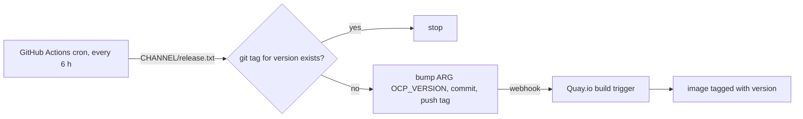

# ocp-release-signature-image

Container image that serves the GPG release signature of an OpenShift
Container Platform (OCP) release over HTTP. Use it as a signature store for
disconnected clusters that cannot reach `mirror.openshift.com`.

Each image holds the signature for exactly one OCP release and is tagged with
that release version, e.g. `4.22.18`.

## What it does

At build time the `Containerfile`:

1. Reads `release.txt` for `OCP_VERSION` from
   `https://mirror.openshift.com/pub/openshift-v4/<arch>/clients/ocp/<version>/release.txt`
   and takes the release image digest from it.
2. Downloads the matching signature from
   `https://mirror.openshift.com/pub/openshift-v4/signatures/openshift/release/sha256=<digest>/signature-1`.
3. Copies it into the web root of a non-root UBI 9 nginx image
   (`registry.access.redhat.com/ubi9/nginx-124`, UID 1001, port 8080).

The signature is served at:

```
http://<host>:8080/sha256%3D<digest>/signature-1
```

nginx decodes `%3D` before looking up the file, so `sha256=<digest>` works too.

## Build locally

```sh
# Version pinned in the Containerfile (ARG OCP_VERSION)
VERSION="$(sed -n 's/^ARG OCP_VERSION=//p' Containerfile)"
podman build -t "ocp-release-signature:${VERSION}" -f Containerfile .

# Any other release
podman build --build-arg OCP_VERSION=4.22.17 -t ocp-release-signature:4.22.17 -f Containerfile .

# Newest release of a mirror channel: stable, stable-4.22, fast-4.22, latest, ...
podman build --build-arg OCP_VERSION=stable -t ocp-release-signature:stable -f Containerfile .
```

| Build arg     | Default                                       | Purpose                              |
|---------------|-----------------------------------------------|--------------------------------------|
| `OCP_VERSION` | pinned in `Containerfile`                     | Release version or mirror channel    |
| `ARCH`        | `x86_64`                                      | Architecture used to look up `release.txt` |
| `MIRROR`      | `https://mirror.openshift.com/pub/openshift-v4` | Mirror base URL                    |

The build fails if `release.txt` or the signature can't be downloaded, or if
`release.txt` contains no digest. It does not verify the signature against
Red Hat's key.

## Run and test

```sh
podman run --rm -p 8080:8080 ocp-release-signature:4.22.18
curl -fO 'http://localhost:8080/sha256%3D<digest>/signature-1'
```

Check the contents with `gpg -d signature-1`. The output names the release
image (`quay.io/openshift-release-dev/ocp-release:<version>-x86_64`) and its
digest.

## Automatic rebuilds on new releases



[`.github/workflows/track-openshift-release.yaml`](.github/workflows/track-openshift-release.yaml)
checks the newest release on `CHANNEL` (default `stable`). If that version has
no git tag yet, the workflow sets `ARG OCP_VERSION` in the `Containerfile`,
commits, and pushes a git tag with the version as its name. A Quay.io build
trigger on that tag builds the image and tags it with the same version.

Quay.io build triggers cannot run on a schedule or pass build args. That's why
the version check runs in GitHub Actions and the version lives in the
`Containerfile`.

### Setup

1. **GitHub:** under *Settings → Actions → General → Workflow permissions*,
   allow *Read and write permissions*. Branch protection on the default branch
   must allow the workflow to push.
2. **Quay.io:** in the image repository, open *Builds → Create Build Trigger →
   GitHub* and select this repository:
   - Dockerfile path `/Containerfile`, context `/`.
   - Restrict the trigger to tag refs, so the version-bump commit on the
     branch doesn't build an image too.
   - Tagging: *Tag manifest with the branch or tag name*. Optionally add a
     `latest` tag template.
3. Run the workflow once by hand (*Actions → Track OpenShift release → Run
   workflow*). Check that a tag is pushed and that Quay starts a build.

To follow one minor version instead of the newest stable release, change
`CHANNEL` in the workflow, e.g. `stable-4.22` or `fast-4.22`.

## Files

| File | Purpose |
|------|---------|
| `Containerfile` | Two-stage build: download the signature, serve it with nginx |
| `.containerignore` | Keeps the build context down to the `Containerfile` |
| `.github/workflows/track-openshift-release.yaml` | Detects new releases and pushes version tags |
